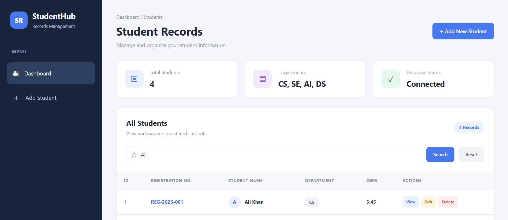
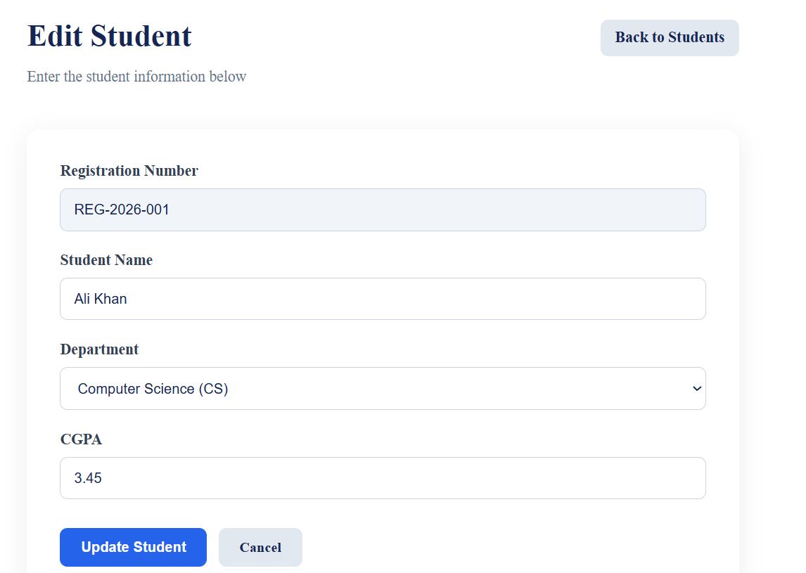

<div align="center">

# 🎓 CampusTrack

### Student Records Management System

A web-based student management application built with **Java 17, Spring Boot, MySQL, and Thymeleaf**.

<p>
  
  
  
  
</p>

[Features](#-features) · [Screenshots](#-screenshots) · [Technology](#-technology-stack) · [Installation](#-getting-started) · [Routes](#-application-routes)

</div>

---

## 📌 About

**CampusTrack** provides a simple interface for managing student records. Users can browse and search records, view student details, and perform create, update, and delete operations.

## ✨ Features

| | Feature | Description |
|---|---|---|
| 📋 | Student Dashboard | View student records in one place |
| 🔎 | Search | Find students by name |
| 👤 | Student Details | View an individual student record |
| ➕ | Add Student | Create a new student record |
| ✏️ | Edit Student | Update existing information |
| 🗑️ | Delete Student | Remove a student record |
| ✅ | Input Validation | Validate required fields and unique registration numbers |
| 📊 | CGPA Validation | Keep CGPA within the 0.00–4.00 range |
| 🗄️ | Database Storage | Persist records with MySQL and JdbcTemplate |

## 🖥️ Screenshots

<p align="center">
  <b>Student Dashboard</b><br/>
  
</p>

<p align="center">
  <b>Add New Student</b><br/>
  
</p>

<p align="center">
  <b>Edit Student</b><br/>
  
</p>

## 🧰 Technology Stack

| Technology | Purpose |
|---|---|
| **Java 17** | Application programming language |
| **Spring Boot** | Backend application framework |
| **Spring MVC** | Web request handling |
| **Spring JdbcTemplate** | Database operations |
| **MySQL** | Relational database |
| **Thymeleaf** | Server-side HTML templates |
| **HTML & CSS** | User interface |
| **Maven** | Build and dependency management |

## 🏗️ Application Architecture

The application uses a layered architecture:

```text
       Browser
          │
          ▼
  StudentController
          │
          ▼
    StudentService
          │
          ▼
 StudentRepository
    (JdbcTemplate)
          │
          ▼
     MySQL Database
```

## 🚀 Getting Started

### Prerequisites

- Java 17
- MySQL Server
- Git

### 1. Clone the repository

```bash
git clone https://github.com/Aleem-Ghafoor/CampusTrack.git
cd CampusTrack
```

### 2. Create the database

Run this SQL in MySQL:

```sql
CREATE DATABASE IF NOT EXISTS scd_records;
USE scd_records;

CREATE TABLE IF NOT EXISTS students (
    id INT AUTO_INCREMENT PRIMARY KEY,
    reg_no VARCHAR(20) NOT NULL UNIQUE,
    name VARCHAR(100) NOT NULL,
    department VARCHAR(50) NOT NULL,
    cgpa DECIMAL(3,2) NOT NULL
);
```

### 3. Configure the database connection

Update `src/main/resources/application.properties` with your local MySQL credentials:

```properties
spring.datasource.url=jdbc:mysql://localhost:3306/scd_records
spring.datasource.username=root
spring.datasource.password=YOUR_PASSWORD
```

> **Security:** Replace the placeholder with your local password. Never commit real credentials to GitHub.

### 4. Run the application

**Windows (PowerShell)**

```powershell
.\mvnw.cmd spring-boot:run
```

**macOS / Linux**

```bash
./mvnw spring-boot:run
```

### 5. Open CampusTrack

Visit **http://localhost:8080/students** in your browser.

## 🧭 Application Routes

| Method | Endpoint | Description |
|---|---|---|
| `GET` | `/students` | List students or search by name |
| `GET` | `/students/{regNo}` | View student details |
| `GET` | `/students/new` | Open the add-student form |
| `POST` | `/students` | Create a student |
| `GET` | `/students/{regNo}/edit` | Open the edit form |
| `POST` | `/students/{regNo}/update` | Update a student |
| `POST` | `/students/{regNo}/delete` | Delete a student |

## 📁 Project Layout

```text
src/
├── main/
│   ├── java/com/scd/studentrecords/
│   │   ├── Student.java
│   │   ├── StudentController.java
│   │   ├── StudentService.java
│   │   ├── StudentRepository.java
│   │   └── StudentrecordsApplication.java
│   └── resources/
│       ├── templates/
│       ├── static/css/
│       └── application.properties
└── test/
```

## 📝 Notes

- Ensure MySQL is running before starting the application.
- Create the `scd_records` database and `students` table before launching.
- Keep database credentials out of version control.
- Database operations are handled using Spring JdbcTemplate.

---

<div align="center">

**CampusTrack** · Student Records Management System

<sub>Built with Java & Spring Boot</sub>

</div>
